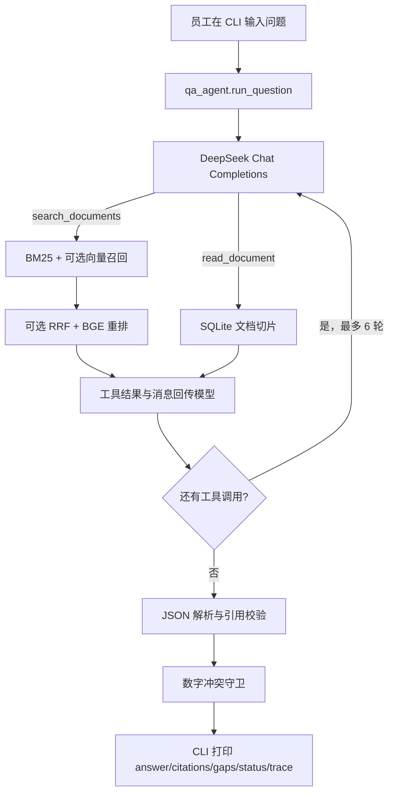

# 02 — 方案、调用流程与关键决策

本文按程序真实执行顺序说明一次问题从终端到答案的路径。代码位置以仓库当前版本为准；行号随修改可能变化，主要用于快速定位。

## 总体结构



| 阶段 | 输入 | 主要处理 | 输出/副作用 | 代码入口 |
|---|---|---|---|---|
| 初始化 | `data/clean/`、`data/meta/manifest.csv`、SQLite | 创建表；数据库为空时导入文档；构造检索索引 | `backend/knowledge.db`、进程内索引、可选向量缓存 | `cli.initialize()`、`ingest.import_clean_docs()` |
| 对话 | 当前问题和 user/assistant 历史 | 组装 system/history/user 消息 | 本轮模型请求 | `cli.repl()`、`qa_agent.run_question()` |
| 检索/读原文 | 模型工具调用参数 | 搜索 top-k 片段或按文档 ID 读出全部已索引切片 | 带 `doc_id`、日期、标题、原文片段的工具结果 | `knowledge_tools.py` |
| 决策与验证 | 模型响应、工具结果 | 最多 6 轮模型决策；解析 JSON；检查引用和数字冲突 | `AgentResult`，包含状态、引用、缺口和 Trace | `qa_agent.py` |
| 展示 | `AgentResult` | 按终端格式渲染 | 终端文本；历史仅保存 user/assistant 答案 | `cli_output.format_result()`、`cli.next_history()` |

源码快速跳转：[CLI 初始化与 REPL](../backend/app/cli.py#L13)、[Markdown 切片与导入](../backend/app/ingest.py#L124)、[模型请求](../backend/app/qa_agent.py#L40)、[最终解析与引用过滤](../backend/app/qa_agent.py#L79)、[Agent 主循环](../backend/app/qa_agent.py#L209)、[BM25/向量/RRF](../backend/app/retrieval.py#L30)。

## 启动：为什么先导入和建索引

CLI 在 `backend/app/cli.py` 的 `initialize()` 中先调用 `init_db()`。随后检查 `documents` 表：如果表里没有文档，才调用 `import_clean_docs()`；若已经存在文档，则跳过重新导入。最后执行 `retrieval.build_index()`，构建 BM25，并尝试加载向量模型和重排模型。

导入流程位于 `backend/app/ingest.py`：读取 manifest 的 `文件名` 字段，将路径解析到 `data/clean/`；从 Markdown 文件和元数据注释读取 ID、标题、类别、来源、更新日期；去掉 front matter/HTML 注释；按标题和段落分段；普通片段最大约 800 字符；保存到 SQLite 的 `documents` 与 `chunks` 表。模型引用的是切片，因此 quote 不一定包含原文件整页文本。

### 需要理解的本地状态

- SQLite 默认位置是 `backend/knowledge.db`。它一旦有任意文档，CLI 不会自动检查 manifest 后再导入新文件。
- FastEmbed 向量缓存位于 `backend/data/embeddings/`，包含向量矩阵和 chunk ID 列表。
- 当前缓存有效性只比较 chunk ID 列表。若原文被改但 chunk ID 顺序没变，向量可能仍是旧内容的向量；BM25 在每次进程启动时从 SQLite 重建，但向量缓存需要显式清理。稳妥重建时同时移除 SQLite 与 `backend/data/embeddings/` 后重启。
- 向量与重排模型首次使用需要下载。代码捕获加载异常并关闭对应功能，尝试回退 BM25；网络下载阻塞仍可能拖慢启动。

## 一轮问题：消息如何组装

`run_question(question, history)` 首先拒绝空白问题，然后创建以下实际协议形态的消息：

```python
[
  {"role": "system", "content": SYSTEM_PROMPT},
  # 之前每轮只保留的 user/assistant 文本消息
  {"role": "user", "content": "当前问题"},
]
```

`SYSTEM_PROMPT` 要求模型只用工具证据、需要时补充搜索或读原文、冲突时请求确认，并以 JSON 返回 `answer/citations/gaps/status`。工具规格通过 OpenAI 兼容 Chat Completions 的 `tools` 参数一并发送，`tool_choice="auto"` 让模型选择是否调用工具，temperature 为 0.1。项目没有保存一份脱敏后的真实在线请求；上面的代码是协议形状示意。

模型发出工具调用时，Assistant 消息会保留 `tool_calls`，程序逐个执行工具，并追加形如 `{ "role": "tool", "tool_call_id": "...", "content": "JSON 工具结果" }` 的消息。下一轮模型请求会继续携带完整的 system、历史、当前问题、assistant tool call 和 tool result。完成本轮后，CLI 的 `next_history()` 只加入 user 问题和 assistant 最终答案，不把内部工具 JSON 作为长期对话历史保存。

## 动态决策与工具边界

### `search_documents`

- 参数：`query` 必填、`top_k` 可选；执行时限制为 1 到 10，默认 5。
- 检索以工具调用中的 query 为准。代码不会在调用前自动改写用户问题；改写检索词由模型根据原问题和对话上下文决定。
- 返回对象含 `doc_id/title/version_date/heading/quote/score`。`quote` 是检索到的 chunk 原文。

### `read_document`

- 参数：`doc_id`。
- 从 SQLite 取该文档全部切片，按 `chunk_index` 排列，返回标题、版本日期和各段文本。它不重新读取磁盘上的 Markdown 文件，所以磁盘改动必须先重新导入数据库。
- 若 doc_id 不存在，`execute_tool()` 当前返回 `{"error": "未找到该文档 ID"}`；这不是异常。Agent 会把它作为一个工具结果回传，Trace 不会标出 `tool_error`，虽然它没有增加可引用证据。后续可考虑把“工具返回业务错误”规范为明确的工具失败状态。
- 模型应在候选片段不足以判断范围、例外或优先级时读取原文。是否读取由模型判断，不是代码无条件触发。

### 检索排序

1. Jieba 对小写问题和 chunk 分词。BM25 用 `k1=1.5`、`b=0.75` 对每段计分，取前 20 个候选（`retrieval.py` 的 `HYBRID_CANDIDATES`）。标点单独 token 会过滤。
2. 向量模型 `paraphrase-multilingual-MiniLM-L12-v2` 对 query 与 chunk 做嵌入，按余弦相似度取最多 20 项。它补充同义表达和语义相近内容，但高相似度不等于事实正确。
3. 如果向量索引可用，BM25 和向量排名用 RRF 融合，常数 `RRF_K=60`。如果向量不可用，直接使用 BM25 排名。
4. 如果 BGE 重排器可用，对融合候选重算分数；重排分和 RRF 分各自归一化后等权组合，再取最终 `top_k`。

这里没有设置基于相似度分数的硬阈值。检索返回空结果意味着 BM25 没有正分命中，或可用索引未命中；它不等于已证明整个企业知识库不存在答案。输出分数也不是答案置信度。

## 最终答案的代码校验

模型无工具调用时，Agent 将其 `content` 解析为 JSON：

1. 非 JSON、非对象、未知状态或空答案返回 `tool_error`。
2. `citations` 的 `doc_id` 必须出现于本轮工具结果；`quote` 必须是对应工具 quote 的子串。违反条件的引用被丢弃。
3. 若模型声称 `answered` 但没有任何剩余引用，降级为 `insufficient_evidence`。
4. 对“与问题相关且多份材料中归一化后句式相同、单位相同、数值不同”的有限数字冲突，代码无视模型选择，改成 `needs_clarification`，引用双方并询问适用范围/优先级。
5. 其他语义冲突主要依赖模型提示词判断。引用子串校验只证明原文里存在这段字，不证明答案的所有结论都能从该引用推出。

工具执行抛异常会立刻以 `tool_error` 结束，避免基于部分证据继续回答。模型 API 异常也走 `tool_error`。每轮最多 6 次模型决策循环；超限返回 `incomplete`。这限制的是循环次数，并非每轮允许的工具调用总数。

## 状态表：用户应如何理解结果

| 状态 | 含义 | 常见原因 | 对用户的下一步 |
|---|---|---|---|
| `answered` | 有至少一条通过引用白名单的证据，模型完成作答 | 单一、相关证据；无已识别冲突 | 检查原文与问题范围是否吻合 |
| `needs_clarification` | 资料存在未解决冲突，或模型判定需要补充范围 | D01/D02 期限不同且没有优先级 | 指明适用制度/部门；资料管理员补充范围规则 |
| `insufficient_evidence` | 没有可核验的支持引用，不能可靠回答 | 资料外问题、空检索、模型给了无效引用 | 补充权威资料或重新描述问题 |
| `tool_error` | 本轮调用模型或工具失败，不能依赖本轮答案 | Key/网络/模型服务/SQLite/检索异常 | 查看 Trace 中的错误并修复后重试 |
| `incomplete` | 达到最大决策轮数仍未产生最终答案 | 模型持续调用工具 | 简化问题或检查工具结果是否无助于决策 |

## 冲突例子：为什么不能只按日期挑一个

D01（2026-01-10）写“30 天”，D02（2026-02-01）写“15 天”。两份资料均未写适用部门，也未指定互相冲突时的优先级。较新的版本日期只是来源元数据，不足以证明 D02 适用全部员工。正确输出应并列陈述两份原文，列出“缺少适用范围/优先级”，并请求确认制度；不得仅因为 15 天版本日期较新就作答 15 天。

离线示例中的模型故意只回答 15 天，用来验证应用层的数字冲突守卫会覆盖这个不安全结论。示例见 [02-conflict.json](../examples/02-conflict.json)。这证明守卫能处理这一种句式，并不代表通用的矛盾检测已经解决。

## 关键设计决策与取舍

| 决策 | 选择与理由 | 放弃/代价 | 什么时候需要改变 |
|---|---|---|---|
| 只保留 CLI | 用户要求只有一种入口；REPL 可直接展示 Trace，部署路径短 | 不支持多人、浏览器共享、服务集成 | 需要多用户服务时，再设计 API 和身份边界，不要直接把 REPL 包进未授权接口 |
| 本地 SQLite | 单机演示容易安装、可复现、适合少量合成资料 | 并发能力、备份和权限较弱；现有迁移能力有限 | 数据量、协作或审计要求提高时评估 PostgreSQL 和迁移工具 |
| 本地原文 + manifest | 文件可审阅、文档 ID/日期能随检索返回，替换资料容易 | 内容质量、元数据和路径需要人工维护；文档扫描/解析有限 | 输入变成 Office/PDF 或管理量变大时，增加经过校验的解析导入流程 |
| BM25 作为基础，语义检索为可选增强 | 中文关键词命中可离线/本地运行，向量能改善改写召回，重排优化前几条 | 模型下载和首次启动成本；缓存失效可能造成旧向量 | 需要质量指标时先建固定测试集，对 BM25、混合和重排做可复现对照 |
| LLM 用 function calling 选工具 | 让模型根据本轮证据动态搜索、读原文或结束，满足 Agent 决策要求 | 依赖在线模型行为和接口；每次调用有延迟与成本 | 需要强确定性或低延迟时，可把高风险判定下沉为可解释规则 |
| 直接使用 OpenAI Python SDK，不再引入 Agent 框架 | DeepSeek 提供 OpenAI 兼容 Chat Completions；当前只有两个工具和一个短循环，直接 SDK 让消息、工具调用和异常路径清晰可见 | 工具循环、结果校验和状态机需要项目自己维护 | 流程变复杂、需要持久化执行、观测或并发控制时，再比较框架能力与引入成本 |
| 工具只读 | Agent 只能找资料，不能审批、改文档或触发业务副作用 | 不支持写回、流程办理 | 若新增写操作，需单独加入权限、二次确认、审计和幂等设计 |
| 代码校验引用 + 有限冲突守卫 | 避免无来源 doc_id/引文，拦截验收例中的数字冲突 | 子串匹配不等于语义蕴含；规则对表述变化敏感 | 扩展为实体/属性抽取、冲突评测集和人工审核闭环 |
| 只保存本次进程中的对话 | 实现简单，离开进程不留员工对话内容 | 无长期记忆、恢复能力和多用户区分 | 需持久化时先明确隐私、保留时间、访问权和删除机制 |
| 用脚本模型做离线编排测试 | 无需 Key、稳定复现动态调用、失败及冲突守卫 | 不测真实 DeepSeek、检索召回或在线稳定性 | 上线或验收前必须补真实 API Trace 和端到端资料替换测试 |

## 证据边界：已经实现什么、没有保证什么

- system prompt 是发给模型的要求，不是强制执行的程序逻辑；只有引用白名单、JSON 状态检查、有限数字冲突守卫和异常分支是代码直接执行的检查。
- `read_document` 返回的是 SQLite 中已导入的切片，不是实时磁盘文件。
- 当前测试中注入的工具响应不经过 BM25/向量/RRF/重排，也不经过真正的 SQLite 导入链路；在线召回质量尚未被这些用例证明。
- Search/read 工具“成功返回”只代表代码执行成功，不代表返回证据完整、适用或正确。
- `answered` 表示至少有一条引用通过来源白名单，不是人工审核后的“完全正确”。

## 修改时从哪儿开始

- 改 REPL 命令和历史：`backend/app/cli.py`、`next_history()`。
- 增加工具：先扩展 `backend/app/knowledge_tools.py` 的 schema 和执行函数，再在 `qa_agent.py` 处理证据形态，并增加替身测试。
- 调整切片：改 `backend/app/ingest.py` 的 `MAX_CHUNK_CHARS` 或分段逻辑；重新导入 DB，并清理向量缓存。
- 调整召回：修改 `backend/app/retrieval.py`；用改写问题测试召回并记录候选，不要只凭单次模型回答判断质量。
- 调整冲突规则：修改 `_numeric_conflicts()` 和 `_parse_final()`，加入同类句式、无关数字、相关冲突和范围明确等正反案例。
- 改输出字段：同步更新 `AgentResult`、`format_result()`、Trace JSON 和评估表，避免文档与 CLI 不一致。
