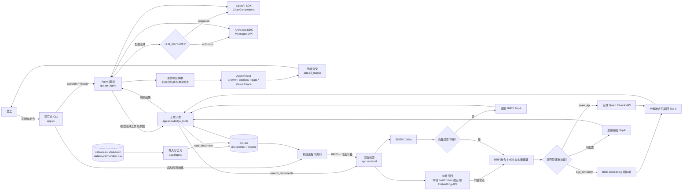
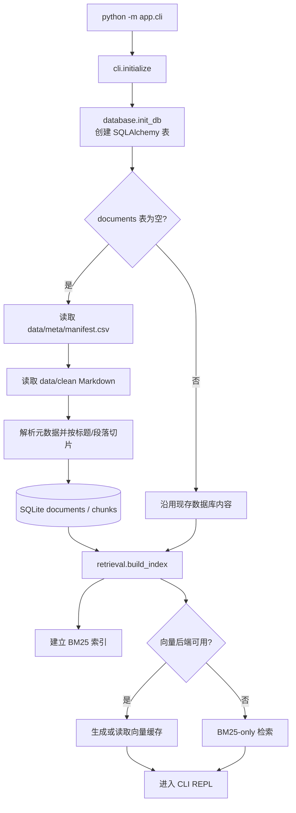
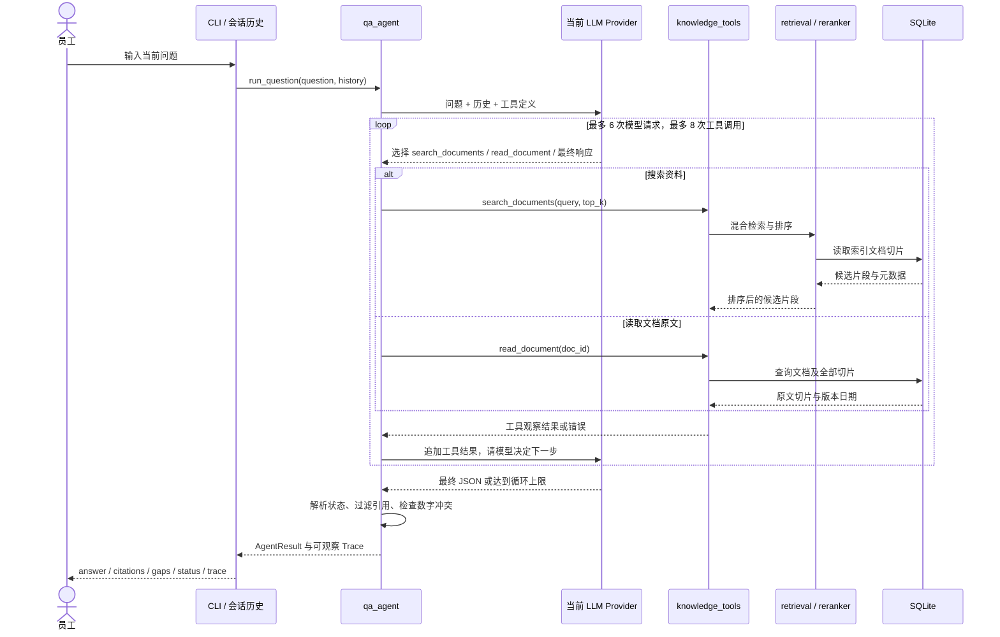
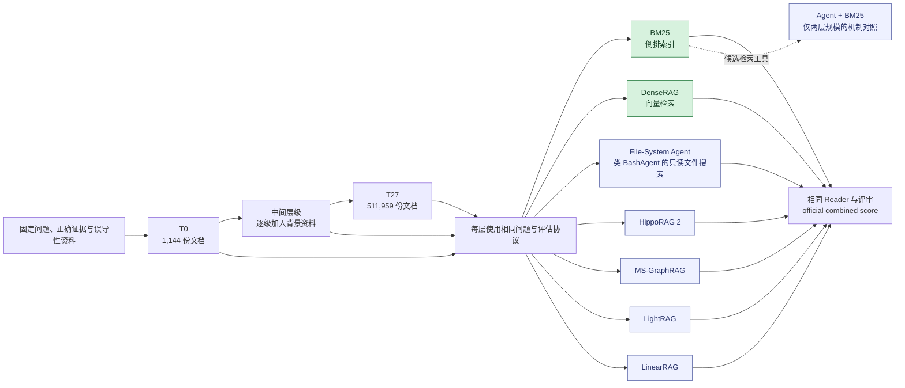

# 项目架构图

架构图展示三个视角：运行时组件、启动建库与索引、单轮 Agent 决策循环。模块关系根据 CodeGraph MCP 的 `codegraph_explore` 调用路径整理，并与源码入口对应。

在仓库根目录可以复查图谱并重新查询：

```powershell
codegraph status
codegraph explore "Trace the CLI question flow through Agent tools, retrieval, reranker, database, and output"
```

图中的外部模型与服务以调用边界表示；其内部实现不属于本仓库。下方[代码对应关系](#代码对应关系)可用于逐项核对。

## 运行时组件



CLI、SQLite、BM25 和工具调度在本地运行。启用远端 Embedding 时，服务生成文档及查询向量；设置 `RERANKER_PROVIDER=qwen_api` 时，候选片段再交给 Qwen Rerank 服务排序。Agent 的最终引用来自本轮工具证据。

## 启动与建库流程



当前启动逻辑只在数据库没有任何文档时导入资料。更新 Markdown 后，需要按 README 删除 SQLite 数据库及向量缓存再启动；只修改源文件不会自动刷新已入库内容。

## 单轮 ReAct 决策循环



模型选择工具和后续动作；Python harness 执行工具、限制次数、适配协议、校验引用并整理状态。达到上限返回 `incomplete`，调用异常返回 `tool_error`。Trace 记录动作、参数、工具结果摘要和后续动作。

## 代码对应关系

| 架构职责 | 源码位置 | 主要边界 |
|---|---|---|
| 唯一用户入口、启动和 REPL | [`backend/app/cli.py`](../backend/app/cli.py) | 管理输入命令、历史和初始化，不实现检索算法 |
| 终端展示 | [`backend/app/cli_output.py`](../backend/app/cli_output.py) | 把 AgentResult 转为人可读输出 |
| Agent 循环、协议映射、证据整理 | [`backend/app/qa_agent.py`](../backend/app/qa_agent.py) | provider 调用、工具循环、最终响应和状态控制 |
| 工具 schema 与分发 | [`backend/app/knowledge_tools.py`](../backend/app/knowledge_tools.py) | 把模型请求映射到检索或 SQLite 读取函数 |
| 文档导入和切片 | [`backend/app/ingest.py`](../backend/app/ingest.py) | manifest/Markdown 到数据库记录的转换 |
| 混合召回、RRF、向量缓存 | [`backend/app/retrieval.py`](../backend/app/retrieval.py) | BM25 与向量召回、融合及第二阶段排序协调 |
| 重排器适配接口 | [`backend/app/reranker.py`](../backend/app/reranker.py) | BGE 相似度与远端 Qwen API 实现统一契约 |
| 数据库连接和表模型 | [`backend/app/database.py`](../backend/app/database.py)、[`backend/app/models.py`](../backend/app/models.py) | SQLite/SQLAlchemy 中的 Document 与 Chunk |
| 用户可替换知识资料 | [`data/clean/`](../data/clean/)、[`data/meta/manifest.csv`](../data/meta/manifest.csv) | 源 Markdown、文档 ID 和版本元数据 |

## 企业语料规模与检索路径：论文对照

[《BM25 Wins at Scale》](https://arxiv.org/html/2607.26497v3)在同一组问题、相关文档和干扰文档保持不变的条件下，将企业语料扩展为 28 个严格嵌套的层级，从 1,144 份文档增至 511,959 份。下图按该论文的方法组织检索路径，供本项目后续设计规模实验时参考；图中的方法名称不表示本仓库均已实现。



绿色表示本项目具备对应的检索基础能力：BM25，以及启用向量后端时的向量召回。本项目实际运行的是 BM25、可选向量召回与 RRF 融合，再由 Agent 调用检索和原文读取工具；它没有复现论文的独立 DenseRAG、文件系统 Agent 或 GraphRAG 实验。论文中的文件系统 Agent 只暴露 `list_dir`、`grep`、`read_doc` 三种只读工具，并非任意 Bash 命令执行。`Agent + BM25` 是论文在最小层与全量层做的检索机制对照，不是 28 层主曲线中的第八种方法。

论文[图 3 与表 1](https://arxiv.org/html/2607.26497v3)显示的规模下降趋势，纵轴是 **official combined score**，即答案正确性约束下的完整度；它不是 Recall@5 曲线。论文为适用的方法统一使用 top-5 文本片段作为检索深度，并另报文档召回率。文中还给出最小层 BM25 的 gold-chunk recall at five 为 75.1%，但没有把它作为图 3 的纵轴。以下是表 1 中选取的实测层级，单位为百分比；空项表示该方法未完成或未评估该层，不是得分为零。

| 方法 | 1,144 文档 | 42,587 文档 | 511,959 文档 |
|---|---:|---:|---:|
| BM25 | 74.7 | 61.2 | 50.5 |
| File-System Agent | 77.4 | 58.9 | 30.7 |
| DenseRAG | 58.1 | 40.7 | 29.9 |
| HippoRAG 2 | 66.2 | 50.5 | — |
| MS-GraphRAG | 45.9 | — | — |
| LightRAG | 48.0 | — | — |
| LinearRAG | 46.2 | 31.3 | — |

若在本项目验证“语料变大时是否下降”，应固定问题、金标准文档、冲突和误导性资料，再逐层加入背景文档；每层分别记录 **Recall@5、答案正确率或完整度、索引成本、查询耗时与工具调用量**。当前仓库没有这组分层实验数据，上表仅引用论文结果，不能作为本项目的效果证明。

## 运行边界

- 产品入口为交互式 CLI。
- SQLite 保存本地资料；对话历史保存在当前进程内存中。
- 向量检索可使用本地 FastEmbed 或 OpenAI-compatible Embedding 服务；是否启用取决于环境配置与初始化结果。
- BGE 相似度排序复用已有向量；远端 Qwen 排序是可选适配器。排序分数只用于候选顺序，不能替代对原文的核对。
- 引用白名单检查片段来源；答案的语义支持程度与复杂冲突还需结合原文单独评估。
