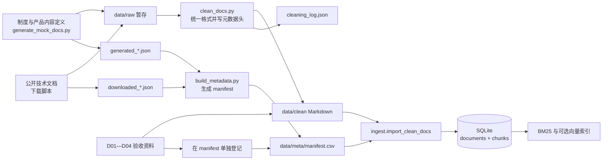

# 07 — 数据来源、加工与入库

本文回答三个问题：知识库里的资料从哪里来，怎样变成可检索片段，以及如何核对当前数据库与源文件。项目运行时直接使用仓库内的 `data/clean/` 和 `data/meta/manifest.csv`；首次建库无需重新下载公开文档。

## 当前资料快照

截至 2026-10-30，`manifest.csv` 记录 237 个唯一文档 ID，所指向的 237 份 Markdown 文件均存在于 `data/clean/`。当前本地 `backend/knowledge.db` 有 237 条 `documents` 记录和 5,381 条 `chunks` 记录。SQLite 是由源资料生成的本地文件，已被 Git 忽略；交付时以仓库内的 Markdown 和 manifest 为可审查的数据快照。

| 资料 | 数量 | 形成方式 | 当前文件位置 |
|---|---:|---|---|
| 虚构企业制度 | 30 | `scripts/generate_mock_docs.py` 按项目定义的制度内容生成 | `data/clean/institutional/` |
| 虚构产品资料 | 25 | 同一脚本生成产品介绍、手册、FAQ 等资料 | `data/clean/products/` |
| 公开技术文档 | 178 | 从 Docker、FastAPI、LangChain、PostgreSQL、Redis 的公开文档取得并清洗 | `data/clean/technical/` |
| 验收用合成资料 | 4 | D01—D04 直接作为项目验收资料维护，并在 manifest 单独登记 | `data/clean/synthetic/` |

虚构的“云启科技”制度和产品资料用于演示，不是现实企业的政策或产品承诺。D01、D02 分别写报销期限 30 天和 15 天，且没有给出适用范围与优先级；D03、D04 用于常规问答和资料缺口场景。验收资料的原文应保持可逐字核对。

## 公开技术文档的来源

逐文件的原始页面 URL、类别、来源说明和许可证字段保存在 [`data/meta/manifest.csv`](../data/meta/manifest.csv)。公开技术文档的 178 行均有原始来源 URL。下载批次的项目、分支、日期和可用的提交记录保存在 `data/meta/downloaded_*.json`。

| 项目 | 文件数 | 当前元数据记录的来源 | 版本定位信息 |
|---|---:|---|---|
| PostgreSQL | 41 | [官方文档页面](https://www.postgresql.org/docs/current/) | 使用 `current` 页面；[批次记录](../data/meta/downloaded_postgresql.json)未包含固定提交 |
| Docker | 38 | [docker/docs](https://github.com/docker/docs) | [批次记录](../data/meta/downloaded_docker.json)包含仓库提交 |
| Redis | 36 | [redis/redis-doc](https://github.com/redis/redis-doc) | [批次记录](../data/meta/downloaded_redis.json)包含仓库提交；许可证字段为 `NOASSERTION` |
| FastAPI | 33 | [fastapi/fastapi](https://github.com/fastapi/fastapi) | [批次记录](../data/meta/downloaded_fastapi.json)包含仓库提交 |
| LangChain | 30 | [langchain-ai/docs](https://github.com/langchain-ai/docs) | 使用 `main` 分支；[批次记录](../data/meta/downloaded_langchain.json)未包含固定提交 |

`downloaded_*.json` 的 `download_date` 均记录为 2026-08-18。技术文档在 manifest 和数据库中的 `更新日期` 使用该批次日期，**不是各上游页面的发布日期或制度生效日**。Docker、Redis 和 FastAPI 的批次元数据保存了仓库提交号；逐文件 URL 仍是分支地址，项目没有保存逐文件下载哈希。LangChain 和 PostgreSQL 没有固定提交号。因此，复核当前内容应以仓库保存的 `data/clean/` 文件为准，重新从上游获取可能得到不同文本。

## 从来源到数据库



### 1. 生成与取得

- [`scripts/generate_mock_docs.py`](../scripts/generate_mock_docs.py) 定义 30 份制度和 25 份产品资料，输出原始 Markdown，并生成 `generated_institutional.json`、`generated_products.json`。脚本中的模拟生效日期为 2026-08-18。
- [`scripts/download_technical_docs.py`](../scripts/download_technical_docs.py) 列出要获取的公开文件；GitHub 文档通过 jsDelivr CDN 获取，PostgreSQL HTML 转为 Markdown。仓库还保留 [PostgreSQL 页面下载脚本](../scripts/download_postgresql_via_web.py)和 [LangChain CDN 下载脚本](../scripts/download_langchain_via_cdn.py)，对应批次记录见 `downloaded_*.json`。
- `data/raw/` 是上述脚本的中间输出目录，当前仓库没有提交该目录。已清洗文件及下载批次元数据保存在仓库中。
- D01—D04 位于 `data/clean/synthetic/`，在 manifest 的最后四行登记；它们不属于 233 份原始资料的清洗日志统计。

### 2. 清洗与登记

[`scripts/clean_docs.py`](../scripts/clean_docs.py) 将原始文件统一为 Markdown：规范换行与空行、清理 MDX frontmatter 和部分 JSX 标签、移除 PostgreSQL 页面目录、修正表格空行，并在文件开头写入文档 ID、类别、来源、获取方式和日期等元数据注释。逐文件处理记录见 [`data/meta/cleaning_log.json`](../data/meta/cleaning_log.json)，共 233 条；汇总见[清洗日志](../data/meta/cleaning_log.md)。

[`scripts/build_metadata.py`](../scripts/build_metadata.py) 根据 `generated_*.json` 和 `downloaded_*.json` 生成主清单。当前 manifest 还包含另行登记的 D01—D04 四行。脚本同时会在指定输出根目录写 `README.md`、`sources.md` 和 `cleaning_log.md`；重新生成时应先使用独立暂存目录，比对结果后再更新仓库，以免覆盖项目文档或丢失验收资料记录。

需要重新运行采集与清洗脚本时，可在仓库根目录使用独立暂存目录：

```powershell
$stageRoot = Join-Path $env:TEMP 'enterprise-qa-data-rebuild'
New-Item -ItemType Directory -Path $stageRoot -Force | Out-Null
uv pip install --python .venv\Scripts\python.exe requests beautifulsoup4
.\.venv\Scripts\python.exe scripts/generate_mock_docs.py $stageRoot
.\.venv\Scripts\python.exe scripts/download_technical_docs.py $stageRoot
.\.venv\Scripts\python.exe scripts/clean_docs.py $stageRoot
.\.venv\Scripts\python.exe scripts/build_metadata.py $stageRoot
```

这些采集依赖用于重取资料，不是 CLI 的运行依赖。`download_technical_docs.py` 需要访问公开网站；重新运行 `main`、`master` 或 `current` 来源时，内容可能不同。上述主清单生成脚本只处理 233 份生成与下载资料，D01—D04 的文件和 manifest 行仍要从当前仓库快照单独保留。比对暂存结果后再决定是否更新正式资料。

manifest 的关键字段包括 `文档编号`、相对于 `data/clean/` 的 `文件名`、`类别`、`来源`、`获取方式`、`更新日期`、`原始来源URL` 和 `许可证`。`许可证` 对合成资料是描述性标记；Redis 的 `NOASSERTION` 表示现有元数据没有给出明确的许可证结论。实际再分发应逐项核对上游条款。

### 3. 导入、切片与检索

CLI 启动时由 [`cli.initialize()`](../backend/app/cli.py) 检查 SQLite：数据库没有文档时，调用 [`import_clean_docs()`](../backend/app/ingest.py) 读取 manifest 和对应 Markdown。导入器优先使用 manifest 中的 ID、类别、来源和日期；缺失时再查文件开头的元数据注释。它去除元数据注释和 frontmatter，按标题及段落切片，单片上限约 800 字符，写入 `documents` 与 `chunks` 两张表。随后从已入库片段建立 BM25 和可选向量索引。

SQLite 的文档记录保存 ID、标题、类别、来源、日期和文件路径；原始 URL、许可证、权限级别等字段仍需到 manifest 查看。manifest 中的权限级别是资料元数据，当前 CLI 没有按它实施访问控制。回答引用的 `quote` 来自已导入片段，因此修改磁盘文件后必须重新导入并重建索引，才能在问答中看到新内容。具体操作见 [README 的“资料格式和重建索引”](../README.md#资料格式和重建索引)。

## 如何复核当前数据

在仓库根目录运行以下只读命令：

```powershell
(Import-Csv data/meta/manifest.csv).Count
(Get-ChildItem data/clean -Recurse -File -Filter *.md).Count
.\.venv\Scripts\python.exe -c "import sqlite3; c=sqlite3.connect('backend/knowledge.db'); print('documents',c.execute('select count(*) from documents').fetchone()[0]); print('chunks',c.execute('select count(*) from chunks').fetchone()[0]); c.close()"
```

当前三个结果依次为 **237、237、`documents 237` / `chunks 5381`**。此外，manifest 的 237 个文档 ID 均唯一，所列相对路径均能定位到文件。数据库是本机派生状态；在其他机器首次运行时，片段数量应以实际导入结果为准。

## 更新资料时的判断

1. **改事实**：修改 `data/clean/` 中的 Markdown，核对文档 ID、适用范围、日期和原文是否仍一致；不要只改数据库或向量缓存。
2. **增文档**：在 manifest 加入唯一 ID、相对路径、类别、来源与日期；公开资料同时登记原始 URL 和许可证信息。
3. **重建**：按 README 清理本地 SQLite 和向量缓存后启动 CLI，让导入、BM25 和向量索引使用同一版文本。
4. **验收**：对同一问题比较更新前后的命中片段、引用原文、答案、资料缺口和状态。D01/D02 冲突关系改变时，追问动作也应随证据改变。

当前脚本保留了资料取得与清洗的实现，但 `data/raw/` 未提交，部分上游来源使用会变化的 `main` 或 `current`。若要做逐字节可重复的数据再构建，下一步需固定所有上游版本并保存文件哈希；日常运行和评审使用已提交的 `data/clean/` 快照即可。
